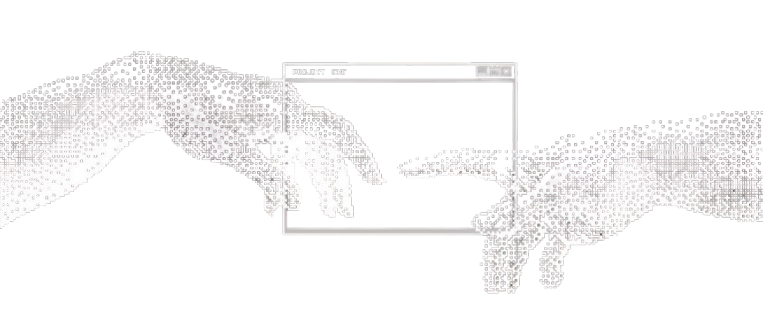
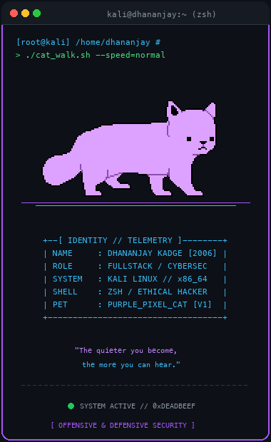

<!-- ============================================================ -->
<!-- 1. HERO / BANNER SECTION (Midnightshady Aesthetic)           -->
<!-- ============================================================ -->

  

<h1 align="center">Hi 👋, I'm Dhananjay Kadge</h1>

<h3 align="center">Full Stack Developer &nbsp;|&nbsp; Cyber Security Engineer</h3>

  

Building secure, scalable systems with clean architecture and robust solutions.

<!-- SOCIAL BADGES -->

  
  &nbsp;&nbsp;&nbsp;
  
  &nbsp;&nbsp;&nbsp;
  
  &nbsp;&nbsp;&nbsp;
  

---

<!-- ============================================================ -->
<!-- 2. STATS & METRICS SHOWCASE (Andrew-Velox Style)             -->
<!-- ============================================================ -->

  
    
  

 

---

<!-- ============================================================ -->
<!-- 3. LANGUAGES - FRAMEWORKS - TOOLS (Andrew-Velox Table Grid)   -->
<!-- ============================================================ -->
<h2 align="center"> Languages-Frameworks-Tools </h2>
 

<table align="center">
  <tr>
    <td align="center" width="96">
      
    </td>
    <td align="center" width="96">
      
    </td>
    <td align="center" width="96">
      
    </td>
    <td align="center" width="96">
      
    </td>
    <td align="center" width="96">
      
    </td>
    <td align="center" width="96">
      
    </td>
    <td align="center" width="96">
      
    </td>
  </tr>

  <tr>
    <td align="center" width="96">
      
    </td>
    <td align="center" width="96">
      
    </td>
    <td align="center" width="96">
      
    </td>
    <td align="center" width="96">
      
    </td>
    <td align="center" width="96">
      
    </td>
    <td align="center" width="96">
      
    </td>
    <td align="center" width="96">
      
    </td>
  </tr>

  <tr>
    <td align="center" width="96">
      
    </td>
    <td align="center" width="96">
      
    </td>
    <td align="center" width="96">
      
    </td>
    <td align="center" width="96">
      
    </td>
    <td align="center" width="96">
      
    </td>
    <td align="center" width="96">
      
    </td>
    <td align="center" width="96">
      
    </td>
  </tr>
</table>

 

---

<!-- ============================================================ -->
<!-- 4. COMPETITIVE PROGRAMMING (Andrew-Velox Style)              -->
<!-- ============================================================ -->

  <h2 align="center">💻 Competitive programming 💻</h2>
   

  
   
  
  

 

<!-- ============================================================ -->
<!-- 5. ACHIEVEMENTS & CONTRIBUTIONS                              -->
<!-- ============================================================ -->

  <h2 align="center">🏆 GitHub Trophies 🏆</h2>
   
  

 

  <h2 align="center">👾 Contribution Arena 👾</h2>
   
  <picture>
    <source media="(prefers-color-scheme: dark)" srcset="https://raw.githubusercontent.com/dhananjay-2006/dhananjay-2006/pacman-output/galaga-contribution-graph-dark.svg?game=galaga">
    <source media="(prefers-color-scheme: light)" srcset="https://raw.githubusercontent.com/dhananjay-2006/dhananjay-2006/pacman-output/galaga-contribution-graph.svg?game=galaga">
    
  </picture>

 

<!-- ============================================================ -->
<!-- 6. FOOTER (Andrew-Velox Style)                               -->
<!-- ============================================================ -->
<h4 align="center">made with  by <a href="https://github.com/DHANANJAY-2006">Dhananjay Kadge</a></h4>

  

